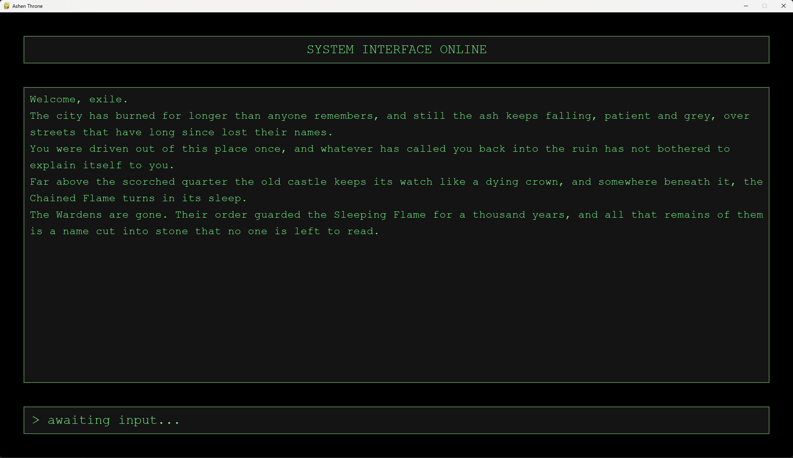

# Ashen Throne

A text-based dark fantasy RPG written in Python, with a retro terminal interface built in Pygame.

**Status:** Console version playable. Pygame interface in progress — layout, text wrapping and the typewriter effect work; the game logic is not connected to it yet.



## Features
- turn-based combat with class-specific attack sets and critical hits
- three player classes: Warrior, Hunter, Mage
- exploration
- NPC encounters and boss fights
- all game text kept in separate modules, apart from the game logic

## Tech
- Python 3.14
- pygame-ce 2.5.8 (interface only — the console version needs no dependencies)

## How to Run

Console version, from the project root:

```bash
py game/main.py
```

Pygame interface prototype:

```bash
py -m venv .venv
.venv\Scripts\python.exe -m pip install -r requirements.txt
.venv\Scripts\python.exe game/ui.py
```

Press Enter or Space to advance the text.

## Project Structure
- `game/main.py` — entry point of the console version
- `game/battle.py` — combat system
- `game/exploration.py` — exploration and random events
- `game/entity_sheet.py` — player and enemy data
- `game/attack_sets.py` — attack definitions
- `game/player_effects.py` — status effects
- `game/lore.py` — names and titles used across the game
- `game/text_*.py` — game texts, kept separate from the mechanics
- `game/ui.py` — Pygame interface prototype

## How I built this

The console version came first. I kept the texts in their own modules from the start, so the
mechanics stay readable and the writing can grow without touching the logic.

The interface is a separate prototype. Three things were worth getting right:

- The window size is derived from the screen resolution instead of being fixed, so the layout
  holds on a laptop as well as on a large monitor. All panels are calculated from the window
  size, and panel heights follow the font height rather than a percentage.
- Text is wrapped *after* it has been cut to the number of visible characters, not before.
  That way the typewriter effect works across several lines without tracking which line it is on.
- An event could be handled before the current text had been assigned, which crashed the first
  frame if a key was pressed immediately. Moving the assignment to the top of the loop fixed it.

## AI assistance

The lore text in the interface prototype and parts of this README were drafted with AI assistance. 
The code is mine, written with AI as a debugging and review partner — explaining errors and discussing approaches, not generating solutions.

## Known limitations
- the interface is not connected to the game logic yet
- no scrolling: once enough text has accumulated, it runs past the bottom of the panel
- the input line is a placeholder and does not accept input

## Planned Improvements
- connect the console logic to the Pygame interface
- loot system
- more event variety and additional boss encounters